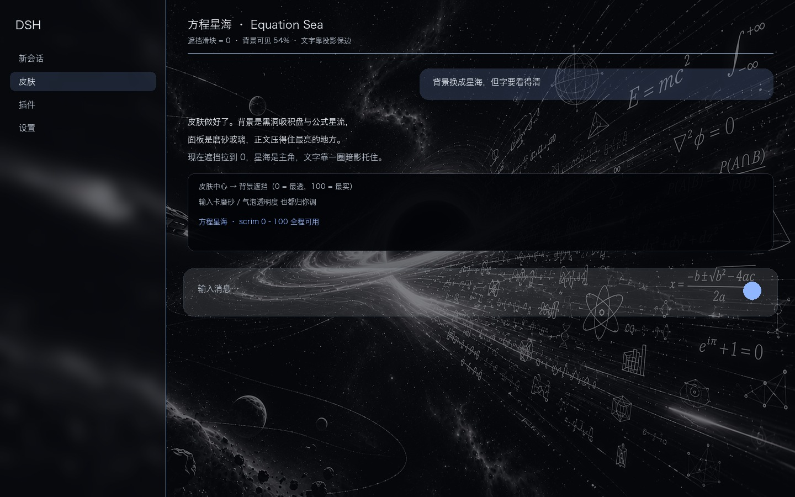
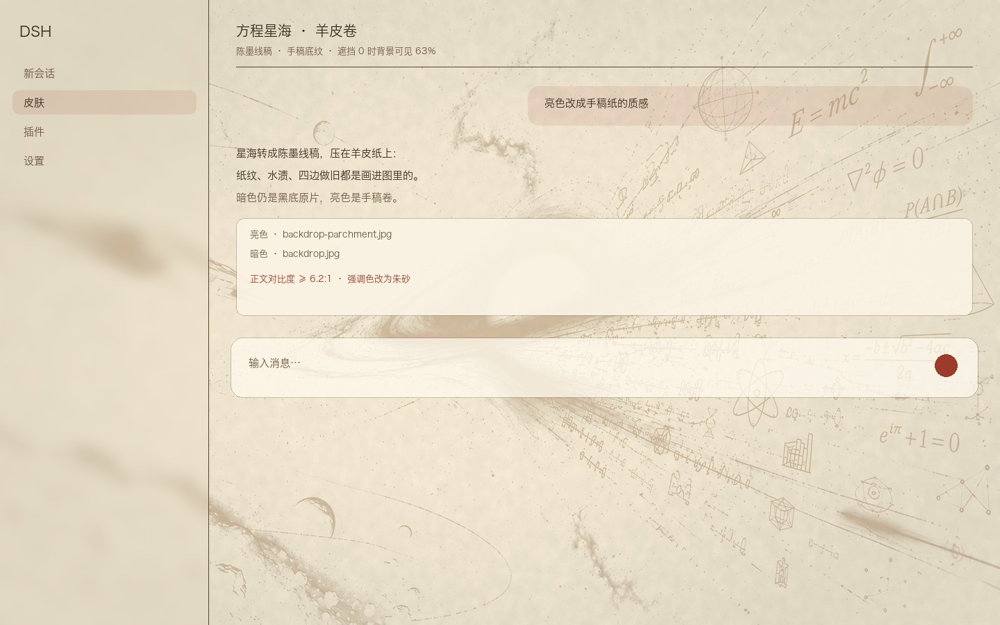

# Equation Sea

[中文](README.zh.md) | English

Turns the DSH Web GUI into a sea of equations: a black-hole accretion disk with
floating Euler formulas and Möbius strips behind the interface, with panels made
of glass whose thickness you can change. A pure asset directory — no
`package.json`, no build step; the skin center is the only loader.



## What it is

- **The backdrop stays visible, the text stays readable** — not by dimming the UI,
  but by trading "glass thickness" for legibility
- **Dark = black glass**: conversation 62% scrim, sidebar 55%, panels 62–78%;
  about 38% of the star field shows through
- **Light = parchment**: the same image turned into an ink line drawing on aged
  paper, with 86–93% white glass and near-black body text
- **The scrim slider drives everything**: every alpha is written as
  `calc(base + var(--dsw-skin-scrim) × delta)`, so the skin center's background
  scrim control keeps working on top of the skin, across the full 0–100% range
- **Code blocks are forced opaque** — the star field must not bleed into syntax
  highlighting
- **No `backdrop-filter` on the composer card** — per the host contract, adding it
  pushes tooltips into the scroll area; this skin uses a hairline inner shadow
  instead

## Readability

Measured with WCAG relative luminance against the **brightest backdrop pixel**,
not estimated:

| Mode | Body | Secondary | AA threshold |
|---|---|---|---|
| Dark | ≥ 8.4 : 1 | ≥ 5.0 : 1 | 4.5 : 1 |
| Light | ≥ 13.2 : 1 | ≥ 4.9 : 1 | 4.5 : 1 |

Even when the brightest formula sits directly behind the text, body copy stays
well above AA.

## Preview



## Files

```
skins/equation-sea/
├── skin.json      v2 manifest (light/dark backdrops + scrims)
├── skin.css       light/dark --dsw-* tokens + glass treatment
├── patches.css    hairlines, opaque code blocks, frosted settings modal
├── NOTICE         asset and license statement
├── assets/        backdrop.jpg / backdrop-parchment.jpg / backdrop-light.jpg
└── preview/       dark.jpg / light.jpg
```

## License and assets

- Stylesheets (`skin.css` / `patches.css` / `skin.json`): CC0-1.0
- Backdrop imagery: provided by the skin author and distributed with the skin;
  provenance and terms are in [NOTICE](NOTICE)

Upstream repository: https://github.com/Chenjiangwen/dsh-skin-equation-sea
