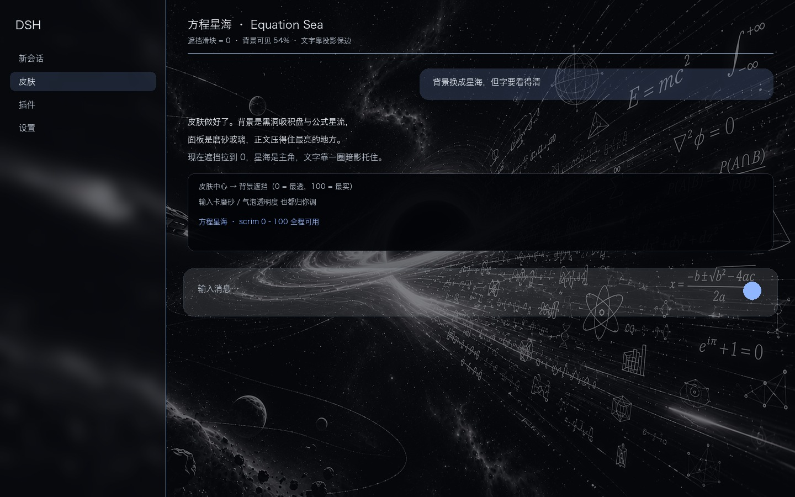
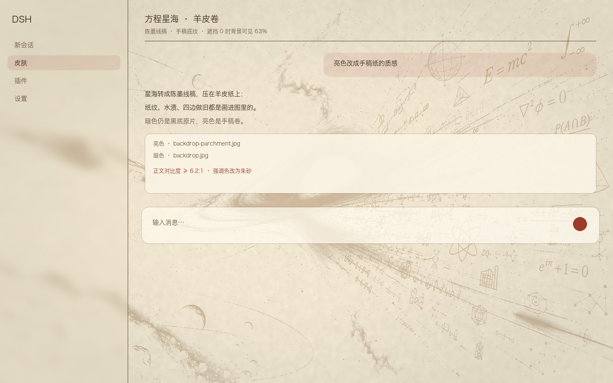

# Equation Sea

中文 | [English](README.md)

把 DSH Web GUI 变成一片**方程星海**：黑洞吸积盘、漂浮的欧拉公式与莫比乌斯环
当背景，面板是一层可以调厚度的玻璃。以纯资产目录形态收录，无 `package.json`、
无构建步骤，皮肤中心是唯一加载器。



## 是什么

- **背景看得见，字也看得清**：不靠把界面调暗，而是用「玻璃厚度」换可读性
- **暗色 = 黑玻璃**：会话区 62% 遮挡、侧栏 55%、面板 62–78%，星海透出约 38%
- **亮色 = 羊皮卷**：同一张图转成陈墨线稿压在做旧纸面上，白雾玻璃 86–93%，正文近黑
- **遮挡滑块接管一切**：所有 alpha 写成 `calc(基础值 + var(--dsw-skin-scrim) × 增量)`，
  皮肤中心的「背景遮挡」滑块可以在皮肤自身的基础上继续加深，0–100% 全程可用
- **代码块强制不透明**：星海不许透进语法高亮里，否则配色全废
- **输入卡不加 `backdrop-filter`**：官方约定，加了会把 tooltip 推进滚动区；
  这里只给发丝内阴影

## 可读性

用 WCAG 相对亮度在**背景最亮像素**上算的，不是估计值：

| 模式 | 正文 | 次要文字 | AA 要求 |
|---|---|---|---|
| 暗色 | ≥ 8.4 : 1 | ≥ 5.0 : 1 | 4.5 : 1 |
| 亮色 | ≥ 13.2 : 1 | ≥ 4.9 : 1 | 4.5 : 1 |

即使背景最亮的那块公式正好落在文字后面，正文依然远高于 AA。

## 预览



## 文件

```
skins/equation-sea/
├── skin.json     v2 清单（亮/暗背景 + 遮罩）
├── skin.css      亮/暗 --dsw-* 令牌 + 玻璃质感
├── patches.css   发丝边、代码块不透明、设置模态磨砂
├── NOTICE        素材与授权说明
├── assets/       backdrop.jpg / backdrop-parchment.jpg / backdrop-light.jpg
└── preview/      dark.jpg / light.jpg
```

## 许可与素材

- 样式表（`skin.css` / `patches.css` / `skin.json`）：CC0-1.0
- 背景图：皮肤作者提供，随本皮肤分发；来源与授权说明见 [NOTICE](NOTICE)

上游仓库：https://github.com/Chenjiangwen/dsh-skin-equation-sea
